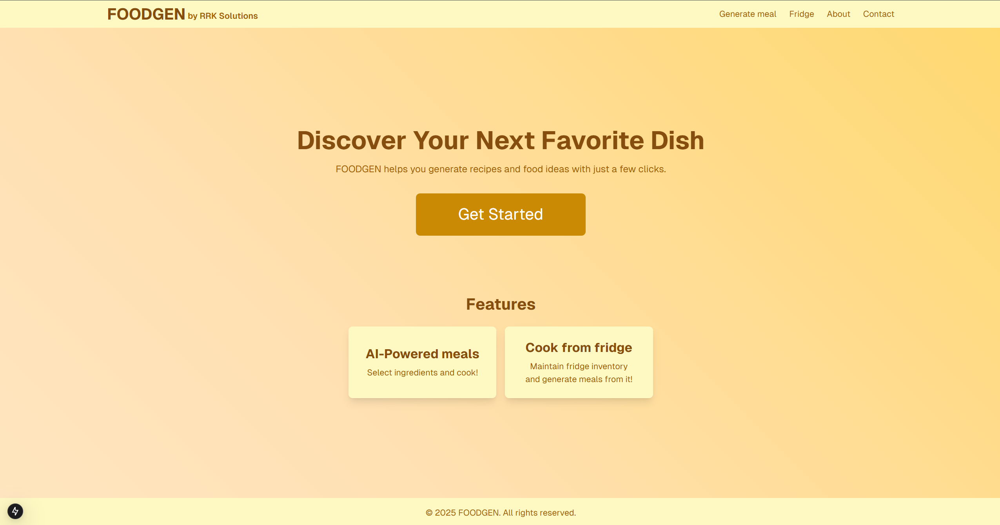

---
# 🧩 Versioning – systém dopĺňa automaticky
fm_version: "1.0.1"

# Dátum buildu – generuje skript
fm_build: "2026-10-05T12:53:05.966717+00:00"

# Poznámka k verzii – voliteľné
fm_version_comment: ""

# 🆔 IDENTITY --------------------------------------------------------

# ID generuje CLI / skript

# Unikátne UUID – generuje skript
guid: "098c1d2b-ee79-486f-b884-b0138472b65f"

# 🧭 CONTEXT ---------------------------------------------------------

# DAO / doména (knife, sdlc, q12, 7ds...) dopĺňa skript
dao: "class_sthdf_dashboard"

# Názov zápisu – dopĺňa používateľ
title: "slides"

# Krátky popis – dopĺňa používateľ (voliteľné)
description: "{{DESCRIPTION}}"

# 👥 AUTHORSHIP ------------------------------------------------------

# Hlavný autor – z globálneho configu
author: "Roman Kazicka"

# Zoznam autorov – generuje skript
authors:
  - "Roman Kazicka"

# 🗂 CLASSIFICATION ---------------------------------------------------

# Nadradená kategória – môže doplniť používateľ
category: ""

# Typ dokumentu (guide, case, tutorial...) – používateľ (voliteľné)
type: ""

# Priorita (low/medium/high) – voliteľné
priority: ""

# Tagy – odporúča sa 2–6 tagov.
# Typy tagov:
#   - rámce: knife, 7ds, sdlc, q12
#   - účel: tutorial, guide, pattern, case-study
#   - téma: git, backup, ai, communication
#   - úroveň: beginner, intermediate, advanced
tags: []

# 🌍 LOCALIZATION -----------------------------------------------------

# Jazyk dokumentu – doplní skript podľa štruktúry
locale: "sk"

# 🕒 LIFECYCLE --------------------------------------------------------

# Dátum vytvorenia – generuje skript
created: "2026-10-05 14:53"

# Dátum poslednej úpravy – dopĺňa človek
modified: "2026-10-05 14:53"

# Stav dokumentu – default "backlog"
status: "backlog"

# Viditeľnosť – default "public"
privacy: "public"

# ⚖ INTELLECTUAL PROPERTY -------------------------------------------

# Držiteľ práv k obsahu – dopĺňa skript
rights_holder_content: "Roman Kazicka"

# Systémový vlastník práv
rights_holder_system: "CAA / KNIFE / LetItGrow"

# Licencia
license: "CC-BY-NC-SA-4.0"

# Disclaimer
disclaimer: "Use at your own risk. Methods provided as-is; participation is voluntary and context-aware."

# Copyright
copyright: "© 2025 Roman Kazicka"

# 🔗 ORIGIN / PROVENANCE ---------------------------------------------

# Repozitár pôvodu
origin_repo: ""

# URL pôvodného repozitára
origin_repo_url: ""

# Commit pôvodu
origin_commit: ""

# Branch pôvodu
origin_branch: ""

# Systém pôvodu (CAA/KNIFE/STHDF…)
origin_system: "CAA"

# Pôvodný autor
origin_author: "Roman Kazicka"

# Importovaný zdroj
origin_imported_from: ""

# Dátum importu
origin_import_date: ""

# 🧱 RESERVED ---------------------------------------------------------

fm_reserved1: ""
fm_reserved2: ""
---

<!-- class_sthdf_dashboard_INSTANCE_ID: 01-class_sthdf_dashboard_2024-2025 -->

[🏠 Domov](../../../index.md) · [⬅️ Nahor](../)
# PRJ008 — Presentation

## Foodgen

## Ingredient-Based Meal Generation:

- Users can manually input ingredients they have at home or search for products via the Open Food Facts API.
- The system allows users to maintain a digital "fridge" inventory by adding or removing ingredients.

## Customizable Recipe Parameters:

- Users can set specific parameters such as the desired number of servings, dietary preferences (e.g., vegetarian, low-carb), and meal preparation time.

## AI-Generated Recipes and Visualizations:

- FoodGen leverages ChatGPT to create detailed step-by-step recipes tailored to the user's selected ingredients and preferences.
- Additionally, the platform can generate realistic images of the prepared dish, providing a complete visualization of the meal.

## Seamless Integration with Open Food Facts:

- The platform retrieves product details, including nutritional values, allergens, and brand information, directly from the Open Food Facts database.
- This ensures that recipes are not only personalized but also nutritionally informative.

## Interactive and Intuitive User Interface:

- The Fridge Page allows users to manage their ingredient list effortlessly, providing an option to search and add products or manually input ingredients.
- Once the ingredients are selected, users can generate meals with a single click, receiving detailed recipe instructions and nutritional information.

## Output Customization and Sharing:

- Users can modify the generated recipes by replacing ingredients or changing serving sizes and regenerate outputs accordingly.
- The platform also offers options for sharing recipes directly on social media or saving them for future use.

## Preview

## mainpage

## fridge page

## integration of open food facts api

## generated meal

## EA model

### Functional requirements

### Business process model

### Activity diagram

## Contributors:

Maroš Kyjovský

Marián Rohun

Branislav Roman

## Follow us

[Linkedin](https://www.linkedin.com/company/105260782)

[Youtube](https://www.youtube.com/@RRK-solutions)
