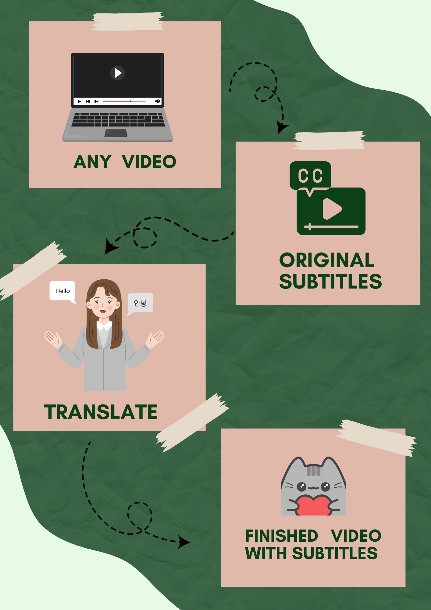

---
# 🧩 Versioning – systém dopĺňa automaticky
fm_version: "1.0.1"

# Dátum buildu – generuje skript
fm_build: "2026-10-05T12:53:05.970043+00:00"

# Poznámka k verzii – voliteľné
fm_version_comment: ""


# 🆔 IDENTITY --------------------------------------------------------

# ID generuje CLI / skript

# Unikátne UUID – generuje skript
guid: "e408a4f6-fe9e-4075-adc7-f847c13624d1"


# 🧭 CONTEXT ---------------------------------------------------------

# DAO / doména (knife, sdlc, q12, 7ds...) dopĺňa skript
dao: "class_sthdf_dashboard"

# Názov zápisu – dopĺňa používateľ
title: "slides"

# Krátky popis – dopĺňa používateľ (voliteľné)
description: "{{DESCRIPTION}}"


# 👥 AUTHORSHIP ------------------------------------------------------

# Hlavný autor – z globálneho configu
author: "Roman Kazicka"

# Zoznam autorov – generuje skript
authors:
  - "Roman Kazicka"


# 🗂 CLASSIFICATION ---------------------------------------------------

# Nadradená kategória – môže doplniť používateľ
category: ""

# Typ dokumentu (guide, case, tutorial...) – používateľ (voliteľné)
type: ""

# Priorita (low/medium/high) – voliteľné
priority: ""

# Tagy – odporúča sa 2–6 tagov.
# Typy tagov:
#   - rámce: knife, 7ds, sdlc, q12
#   - účel: tutorial, guide, pattern, case-study
#   - téma: git, backup, ai, communication
#   - úroveň: beginner, intermediate, advanced
tags: []


# 🌍 LOCALIZATION -----------------------------------------------------

# Jazyk dokumentu – doplní skript podľa štruktúry
locale: "sk"


# 🕒 LIFECYCLE --------------------------------------------------------

# Dátum vytvorenia – generuje skript
created: "2026-10-05 14:53"

# Dátum poslednej úpravy – dopĺňa človek
modified: "2026-10-05 14:53"

# Stav dokumentu – default "backlog"
status: "backlog"

# Viditeľnosť – default "public"
privacy: "public"


# ⚖ INTELLECTUAL PROPERTY -------------------------------------------

# Držiteľ práv k obsahu – dopĺňa skript
rights_holder_content: "Roman Kazicka"

# Systémový vlastník práv
rights_holder_system: "CAA / KNIFE / LetItGrow"

# Licencia
license: "CC-BY-NC-SA-4.0"

# Disclaimer
disclaimer: "Use at your own risk. Methods provided as-is; participation is voluntary and context-aware."

# Copyright
copyright: "© 2025 Roman Kazicka"


# 🔗 ORIGIN / PROVENANCE ---------------------------------------------

# Repozitár pôvodu
origin_repo: ""

# URL pôvodného repozitára
origin_repo_url: ""

# Commit pôvodu
origin_commit: ""

# Branch pôvodu
origin_branch: ""

# Systém pôvodu (CAA/KNIFE/STHDF…)
origin_system: "CAA"

# Pôvodný autor
origin_author: "Roman Kazicka"

# Importovaný zdroj
origin_imported_from: ""

# Dátum importu
origin_import_date: ""


# 🧱 RESERVED ---------------------------------------------------------

fm_reserved1: ""
fm_reserved2: ""
---

<!-- class_sthdf_dashboard_INSTANCE_ID: 01-class_sthdf_dashboard_2024-2025 -->

[🏠 Domov](../../../index.md) · [⬅️ Nahor](../)
# PRJ009 — Presentation


## 🌍 UniversalSubs - Videá bez hraníc! 🎥

UniversalSubs je aplikácia, ktorá umožňuje generovať a prekladať titulky pre YouTube videá pomocou umelej inteligencie. Jednoducho vložte odkaz na video, vyberte jazyk a získajte presné titulky v priebehu niekoľkých sekúnd!  

---

## 📜 **Funkcionality**
- **Preklad titulkov:** Podpora viacerých jazykov cez AI modul.  
- **Prispôsobenie:** Úprava a export titulkov vo formáte, ktorý potrebujete.
- **Vloženie tituliek:** Vkladanie nových upravených tituliek do požadovaného videa.

---

## 🗂️ **Štruktúra projektu**
- **`/promo_images`**  
  Obsahuje promo obrázky, ktoré môžete použiť na prezentáciu projektu.  

- **`/python`**  
  Obsahuje zdrojový kód aplikácie vrátane všetkých funkcií pre spracovanie videí, generovanie titulkov a UI aplikácie.  

- **`/model`**  
  Obsahuje predtrénované modely a súbory pre AI modul na generovanie a prekladanie titulkov.  

---

## 🚀 **Ako spustiť aplikáciu?**

### **1. Klonovanie repozitára**
Najskôr si stiahnite projekt:  
```bash
git clone https://github.com/yourusername/yourtube-translate.git
cd yourtube-translate
```

## **2. Inštalácia závislostí**
Uistite sa, že máte nainštalovaný Python 3.9+, a následne nainštalujte všetky potrebné balíčky:
pip install -r requirements.txt

## **3. Spustenie aplikácie**
Aplikáciu môžete spustiť nasledujúcim príkazom:
```bash
python app/main.py
```


## 📊 **Ako funguje AI modul?**
Preklad titulkov:
Preklady zabezpečuje moderný jazykový model uložený v adresári /model. Tento model je schopný spracovať rôzne jazyky s vysokou presnosťou.

## 📸 **Promo obrázky**
V priečinku /promo_images nájdete promo materiály na prezentáciu projektu. Tieto obrázky môžete použiť na marketingové účely alebo ich zdieľať s komunitou.




## 💡 **Budúce plány**
Offline spracovanie: Možnosť používať aplikáciu bez pripojenia na internet.  
Viacjazyčné titulky: Generovanie jedného súboru tituliek, ktoré obsahujú rôzne jazyky.  
Rozšírené UI nástroje: Integrácia editoru pre úpravu časovania a obsahu titulkov.
